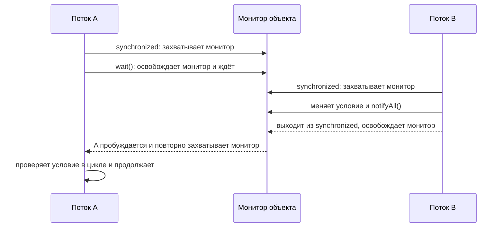

## *Thread*

- [Чем отличается процесс от потока?]()
- [Каким образом можно создать поток?]()
- [Как работают методы sleep, yield, wait, notify и notifyAll?]()
- [Объясните следующие термины: монитор, мьютекс, критическая секция.]()
- [Как работает join()?]()
- [Что такое DeadLock? Приведите примеры.]()
- [Назовите различия между Collections.synchronizedMap(new HashMap()) и ConcurrentHashMap.]()
- [Различия в интерфейсах Runnable и Callable.]()
- [Различия между isInterrupted(), interrupted(), interrupt().]()
- [Что происходит при вызове Thread.interrupt()?]()
- [Перечислите ВСЕ причины по которым может быть выброшено InterruptedException.]()
- [Назовите отличия synchronized{} и ReentrantLock.]()
- [Приведите наиболее существенное отличие между CountDownLatch и CyclicBarrier.]()
- [Приведите наиболее существенное отличие между CyclicBarrier и Phaser.]()
- [Расскажите про Exchanger.]()
- [Отличие Thread.start() и Thread.run()?]()
- [Объясните ключевое слово volatile.]()
- [Расскажите про приоритеты потока.]()
- [Что такое потоки-демоны?]()
- [Назовите все возможные состояния потока.]()
- [Что такое race condition?]()
- [Что такое Thread Local переменная? ]()
- [Что такое FutureTask?]()
- [Что такое Thread Pool?]()
- [Что такое Semaphore?]()
- [Чем отличается submit от execute у ExecutorService?]()
- [Чем отличается shutdown от shutdownNow у ThreadPoolExecutor?]()
- [Как создать ThreadPool у ExecutorService только на 1, на 5, на неограниченное количество потоков.]()
- [Что такое ReadWriteLock?]()
- [В чём отличие Thread от FutureTask? В чём отличие Thread.interrupt() и FutureTask.cancel().]()
- [Расскажите про шаблон проектирования Producer Consumer.]()
- [Как можно запустить параллельный поток (parallelStream)?]()
- [Что делают методы parallel и sequential?]()
- [Расскажите про порядок следования элементов в параллельном потоке и его особенностях.]()
- [В чем разница между методами forEach и forEachOrdered?]()
- [В чем разница между применением метода peek() в последовательном и параллельном потоках?]()
- [Что делает метод unordered?]()
- [Когда имеет смысл распараллеливать поток и какие при этом должны соблюдаться условия?]()
- [Расскажите про Java NIO и её главные составляющие.]()
- [Что такое канал?]()
- [Что такое буфер?]()
- [Что такое селектор?]()
- [Когда есть смысл использовать Java NIO?]()
- [Что такое PipedStreams? Как они устроены?]()

---

### 1. Чем отличается процесс от потока?
**Процесс** — запущенная изолированная программа со своим адресным пространством и ресурсами ОС. **Поток** — путь выполнения внутри процесса; потоки одного процесса разделяют heap и ресурсы, но имеют собственный стек и состояние выполнения. Создание потока обычно дешевле создания процесса, а обмен данными между потоками проще, но общая память требует синхронизации. Ошибка одного потока может повлиять на весь процесс.

### 2. Каким образом можно создать поток?
В Java задачу обычно описывают через `Runnable` (без результата) или `Callable<V>` (с результатом и проверяемыми исключениями), а выполняют через `Thread` либо `ExecutorService`:
```java
Thread t = new Thread(() -> doWork());
t.start();

ExecutorService pool = Executors.newFixedThreadPool(4);
Future<Result> result = pool.submit(() -> calculate());
```
Можно расширить `Thread`, но чаще задачу отделяют от механизма исполнения и используют executor. Для конкурентного кода также доступны `CompletableFuture` и, начиная с Java 21, виртуальные потоки (`Thread.ofVirtual()` / `Executors.newVirtualThreadPerTaskExecutor()`).

### 3. Как работают методы sleep, yield, wait, notify и notifyAll?
`Thread.sleep(...)` приостанавливает текущий поток на время и **не освобождает** захваченные им мониторы; может выбросить `InterruptedException`. `Thread.yield()` лишь предлагает планировщику дать шанс другим потокам — гарантий нет. `Object.wait()` вызывается только при владении монитором этого объекта, атомарно освобождает его монитор и ждёт уведомления, прерывания или таймаута; после пробуждения поток снова должен захватить монитор. `notify()` будит один произвольный ожидающий поток, `notifyAll()` — все; уведомление не передаёт монитор, разбуженный поток продолжит после его повторного захвата. `wait` следует вызывать в цикле с проверкой условия, обычно внутри `synchronized`.



### 4. Объясните следующие термины: монитор, мьютекс, критическая секция.
**Монитор** — механизм синхронизации, связывающий взаимное исключение с ожиданием/уведомлением; каждый Java-объект может служить монитором для `synchronized` и `wait/notify`. **Мьютекс** — механизм, который в каждый момент допускает в защищённую область только одного владельца; часто термин употребляют как синоним блокировки взаимного исключения. **Критическая секция** — участок кода, обращающийся к общему изменяемому состоянию и потому требующий координации. Синхронизировать нужно по одному и тому же стабильному объекту.

### 5. Как работает join()?
`thread.join()` заставляет **текущий** поток ждать завершения указанного `thread`; есть варианты с таймаутом в миллисекундах и наносекундах. Метод можно прервать (`InterruptedException`). Успешный возврат из `join` также обеспечивает видимость действий завершившегося потока для ожидавшего потока (happens-before). Сам `join` не запускает поток: для этого вызывают `start()`.

### 6. Что такое DeadLock? Приведите примеры.
**Deadlock (взаимная блокировка)** — ситуация, когда потоки бесконечно ждут ресурсы, удерживаемые друг другом. Пример: поток A захватил `lock1` и ждёт `lock2`, а поток B захватил `lock2` и ждёт `lock1`. Типичные необходимые условия: взаимное исключение, удержание ресурса во время ожидания, отсутствие принудительного отъёма и циклическое ожидание. Помогают единый порядок захвата блокировок, короткие критические секции и таймауты (`tryLock`).

### 7. Назовите различия между Collections.synchronizedMap(new HashMap()) и ConcurrentHashMap.
`Collections.synchronizedMap` оборачивает карту общей блокировкой: операции сериализуются; во время обхода через iterator/`entrySet` клиент должен вручную синхронизироваться на самой обёртке. `ConcurrentHashMap` рассчитана на конкурентный доступ, использует более тонкую внутреннюю синхронизацию и обычно обеспечивает лучшую параллельность чтения и обновления. Её итераторы weakly consistent и не требуют внешней блокировки; `null` ключи и значения запрещены. Составные операции следует выполнять атомарными методами вроде `compute`, `merge`, `putIfAbsent`, а не последовательностью отдельных вызовов.

### 8. Различия в интерфейсах Runnable и Callable.
`Runnable.run()` не возвращает значение и не объявляет проверяемые исключения. `Callable<V>.call()` возвращает `V` и может объявлять `Exception`. Оба интерфейса представляют задачу, но `Callable` обычно передают в `ExecutorService.submit`, получая `Future<V>` для результата, ожидания или отмены. `Runnable` можно передать в `Thread` или executor; у `submit(Runnable)` тоже возвращается `Future<?>`, но успешный результат обычно `null`.

### 9. Различия между isInterrupted(), interrupted(), interrupt().
`thread.isInterrupted()` проверяет флаг прерывания указанного потока и не сбрасывает его. Статический `Thread.interrupted()` проверяет флаг **текущего** потока и сбрасывает его. `thread.interrupt()` устанавливает флаг прерывания целевого потока; если тот находится в прерываемом ожидании, ожидание обычно завершается `InterruptedException`, а флаг при этом очищается. Это кооперативный сигнал, а не принудительное завершение.

### 10. Что происходит при вызове Thread.interrupt()?
Вызов устанавливает статус interrupt. Поток, выполняющий обычный код, сам должен проверять статус и корректно завершаться или передавать сигнал дальше. Если поток блокируется в `sleep`, `wait`, `join` или другом interruptible-методе, метод обычно выбросит `InterruptedException` и очистит статус. Если обработчик перехватил исключение, но не может завершить задачу, часто восстанавливают флаг: `Thread.currentThread().interrupt()`. Нельзя рассчитывать, что `interrupt()` мгновенно остановит поток.

### 11. Перечислите ВСЕ причины по которым может быть выброшено InterruptedException.
Закрытого перечня для всей Java-экосистемы нет: исключение объявляют interruptible-операции JDK и сторонние библиотеки. Основные стандартные группы: `Object.wait`, `Thread.sleep`, `Thread.join`; `Lock.lockInterruptibly` и `Condition.await`; ожидания синхронизаторов (`CountDownLatch.await`, `CyclicBarrier.await`, `Phaser.awaitAdvanceInterruptibly`, `Semaphore.acquire`); блокирующие методы `BlockingQueue` (`put`, `take` и timed `offer`/`poll`); `Future.get`. Проверяйте сигнатуру конкретной перегрузки и её Javadoc. Важно не смешивать разные способы реакции на interrupt: `InterruptibleChannel` при прерывании блокирующего I/O закрывает канал и обычно приводит к `ClosedByInterruptException` (это `IOException`, не `InterruptedException`); прерывание потока, заблокированного в `Selector.select()`, будит его и задаёт interrupt status, но `select()` не объявляет `InterruptedException`. Сам вызов `interrupt()` не выбрасывает это исключение в вызывающем потоке.

### 12. Назовите отличия synchronized{} и ReentrantLock.
Оба обеспечивают взаимное исключение и повторный захват владельцем. `synchronized` автоматически освобождает монитор при выходе из блока, включая исключение; синтаксис проще и блокировка связана с монитором объекта. `ReentrantLock` требует парного `unlock()` обычно в `finally`, но даёт `tryLock` с таймаутом, прерываемый `lockInterruptibly`, настраиваемую справедливость, несколько `Condition` и диагностику очереди ожидания. Выбирают его, когда нужны эти возможности; иначе `synchronized` обычно проще и менее подвержен ошибкам освобождения.

### 13. Приведите наиболее существенное отличие между CountDownLatch и CyclicBarrier.
`CountDownLatch` — одноразовый счётчик: один или несколько потоков ждут, пока другие выполнят заданное число `countDown`; сам ожидающий поток не обязан уменьшать счётчик. Повторно использовать нельзя. `CyclicBarrier` рассчитан на фиксированную группу участников, которые сами вызывают `await`; когда все дошли до барьера, они продолжают, и барьер можно использовать в следующих циклах. У барьера также может быть действие, выполняемое при его открытии.

```text
CountDownLatch:  worker A --countDown--┐
                 worker B --countDown--┼--> счётчик 0 --> ожидающие продолжают
                 main     ----await----┘       (одноразовый)

CyclicBarrier:   worker A --await-------┐
                 worker B --await-------┼--> все участники дошли --> следующая фаза
                 worker C --await-------┘                         (барьер повторяемый)
```

### 14. Приведите наиболее существенное отличие между CyclicBarrier и Phaser.
`CyclicBarrier` имеет фиксированное число участников на цикл. `Phaser` позволяет динамически регистрировать и снимать участников, поддерживает фазы и даёт больший контроль над продвижением и завершением. `Phaser` удобен, если количество участников или структура фаз меняются; для простой фиксированной группы достаточно `CyclicBarrier`.

### 15. Расскажите про Exchanger.
`Exchanger<V>` — точка встречи для двух потоков: каждый вызывает `exchange(value)` и получает значение, переданное другим участником. Вызов ждёт второго участника; есть вариант с таймаутом. Применяется, например, для обмена буферами между производителем и потребителем. Если второй участник не придёт, ожидание можно прервать или ограничить таймаутом.

### 16. Отличие Thread.start() и Thread.run()?
`start()` планирует запуск нового потока; JVM затем вызывает его `run()`, и выполнение идёт параллельно с вызывающим потоком. Запустить один объект `Thread` повторно нельзя. Прямой вызов `run()` — обычный вызов метода в текущем потоке, новый поток не создаётся.

### 17. Объясните ключевое слово volatile.
`volatile` для поля гарантирует видимость записи между потоками и упорядочивание: запись в volatile happens-before последующего чтения того же поля. Это подходит для флагов и публикации простых значений, но не делает составные операции атомарными: `volatile int count; count++` всё ещё может терять обновления. Для таких операций нужны синхронизация, атомики или блокировки. `volatile` не заменяет защиту инвариантов между несколькими полями.

### 18. Расскажите про приоритеты потока.
Приоритет задаётся `setPriority` в диапазоне `Thread.MIN_PRIORITY`–`MAX_PRIORITY` (обычно 1–10), стандартное значение — `NORM_PRIORITY` (5). Это подсказка планировщику, а не гарантия порядка или времени выполнения; поведение зависит от JVM и ОС. На приоритет нельзя опираться для корректности программы. Поток наследует приоритет создавшего его потока, если его отдельно не изменить.

### 19. Что такое потоки-демоны?
Daemon-поток — фоновый поток, который сам по себе не удерживает JVM от завершения. Когда завершились все обычные (non-daemon) потоки, JVM может завершиться, не дожидаясь демонов и не гарантируя выполнение их `finally` или очистки. Статус задают через `setDaemon(true)` до `start()`. Для обязательной финализации работы используйте явное завершение и ожидание, а не daemon-поток.

### 20. Назовите все возможные состояния потока.
`Thread.State` содержит шесть состояний: `NEW` (создан, ещё не запущен), `RUNNABLE` (выполняется или готов к исполнению; отдельного состояния RUNNING в Java нет), `BLOCKED` (ждёт входа в монитор), `WAITING` (ждёт без таймаута, например `wait()`/`join()` без таймаута), `TIMED_WAITING` (ждёт с таймаутом, например `sleep` или timed `join`), `TERMINATED` (выполнение завершено). Это состояния JVM, а не все состояния планировщика ОС.

### 21. Что такое race condition?
**Состояние гонки** возникает, когда результат зависит от непредсказуемого чередования потоков при доступе к общим данным, особенно если есть конкурентные записи. Например, два потока одновременно выполняют неатомарный `count++` и теряют одно обновление. Устраняют гонки синхронизацией, атомарными классами, неизменяемыми данными или передачей владения. Даже если гонка не портит данные, зависимость от порядка выполнения может быть логической ошибкой.

### 22. Что такое Thread Local переменная?
`ThreadLocal<T>` хранит отдельное значение для каждого потока: вызовы `get/set` из разных потоков не делят одну запись. Используют, например, для контекста запроса или локального форматтера. В пулах поток переиспользуется, поэтому после работы нужно вызывать `remove()`, иначе значение может попасть в следующую задачу и удерживать объекты в памяти. `ThreadLocal` не является способом синхронизации общей переменной.

### 23. Что такое FutureTask?
`FutureTask<V>` реализует и `Runnable`, и `Future<V>`: оборачивает `Callable` (или `Runnable` с результатом) и может быть передан в `Thread` или executor. `run()` выполняет задачу один раз; `get()` возвращает результат, ожидая завершения, либо сообщает об исключении через `ExecutionException`. `cancel(mayInterruptIfRunning)` пытается отменить задачу; флаг `true` может послать работающему потоку interrupt, но задача должна реагировать на него. `FutureTask` можно вручную завершить через `set`/`setException` в подклассе.

### 24. Что такое Thread Pool?
Пул потоков переиспользует рабочие потоки для выполнения множества задач, снижая стоимость частого создания потоков и позволяя ограничивать параллелизм. Обычно executor хранит очередь задач, управляет запуском и предоставляет `Future` через `submit`. Размер пула и очередь выбирают по нагрузке: неограниченная очередь может привести к задержкам и росту памяти, а неограниченное число потоков — исчерпать ресурсы. Пул нужно завершать через `shutdown`.

### 25. Что такое Semaphore?
`Semaphore` хранит число разрешений (permits). `acquire()` получает разрешение или ждёт, `release()` возвращает его; семафор с одним разрешением может ограничивать доступ к ресурсу, с несколькими — допускать заданное число одновременных операций. В отличие от mutex, семафор не требует, чтобы разрешение возвращал именно захвативший его поток. Важно возвращать permit в `finally`, если работа завершилась с ошибкой.

### 26. Чем отличается submit от execute у ExecutorService?
`execute(Runnable)` запускает задачу и ничего не возвращает; исключение из неё обычно попадает в `UncaughtExceptionHandler` рабочего потока. `submit(...)` возвращает `Future`: через него можно дождаться результата, получить исключение (как `ExecutionException`) или отменить задачу. Ошибки задачи, отправленной через `submit`, сохраняются внутри `Future` и могут остаться незамеченными, если его результат не проверять.

### 27. Чем отличается shutdown от shutdownNow у ThreadPoolExecutor?
`shutdown()` запрещает принимать новые задачи, но выполняет уже принятые и не ждёт их завершения. `shutdownNow()` пытается прервать активные задачи, прекращает обработку очереди и возвращает задачи, которые не начали выполняться; прерывание кооперативное, поэтому работающие задачи могут не остановиться сразу. Для ожидания завершения используют `awaitTermination`; после `shutdownNow` задачи должны корректно реагировать на interrupt.

### 28. Как создать ThreadPool у ExecutorService только на 1, на 5, на неограниченное количество потоков.
```java
ExecutorService one = Executors.newSingleThreadExecutor();
ExecutorService five = Executors.newFixedThreadPool(5);
ExecutorService cached = Executors.newCachedThreadPool();
```
`newCachedThreadPool()` не означает безопасную бесконечную мощность: он может создавать много потоков и переиспользует простаивающие, поэтому при больших/неограниченных нагрузках возможен расход ресурсов. В серверном коде часто предпочтительнее явно настроенный `ThreadPoolExecutor` с ограниченным максимумом и очередью. Пулы следует завершать через `shutdown()`.

### 29. Что такое ReadWriteLock?
`ReadWriteLock` разделяет блокировку на read-lock и write-lock: одновременно допускаются несколько читателей, но писатель получает исключительный доступ и несовместим с читателями. В Java стандартная реализация — `ReentrantReadWriteLock`. Она полезна, когда чтений существенно больше, чем записей, и операции достаточно долгие, чтобы выигрыш превысил накладные расходы. Нельзя автоматически повышать read-lock до write-lock; такие сценарии требуют аккуратного освобождения и повторного захвата.

### 30. В чём отличие Thread от FutureTask? В чём отличие Thread.interrupt() и FutureTask.cancel().
`Thread` представляет поток исполнения, а `FutureTask` — задачу с состоянием, результатом и возможностью отмены; `FutureTask` можно исполнять в отдельном `Thread` или в пуле. `Thread.interrupt()` посылает потоку кооперативный сигнал и сам по себе не меняет состояние `Future`. `FutureTask.cancel(true)` пытается пометить задачу отменённой и, если она уже выполняется, прервать исполняющий её поток; `cancel(false)` не посылает interrupt. Отмена не гарантирует остановку кода, который игнорирует прерывание.

### 31. Расскажите про шаблон проектирования Producer Consumer.
Производитель создаёт элементы, потребитель их обрабатывает, а потокобезопасная очередь связывает их и отделяет скорость работы сторон. В Java обычно используют `BlockingQueue`: producer вызывает `put`, consumer — `take`; очередь сама обеспечивает синхронизацию и может ограничивать буфер, создавая backpressure. Для остановки потребителей применяют согласованный сигнал завершения (например, poison pill) и корректно обрабатывают прерывания. Самодельные wait/notify требуют проверок условия в цикле и легко приводят к ошибкам.


### 32. Как можно запустить параллельный поток (parallelStream)?
Из коллекции можно вызвать `collection.parallelStream()`, либо преобразовать существующий поток через `stream.parallel()`. Терминальная операция запускает обработку, обычно в общем `ForkJoinPool`. Параллельный stream — не отдельный `Thread`; реализация разбивает задачу на части и объединяет результаты. Не следует использовать общий изменяемый аккумулятор в `forEach`; лучше применять корректные reduction/collector-операции.

### 33. Что делают методы parallel и sequential?
`parallel()` помечает pipeline как параллельный, `sequential()` — как последовательный. Режим является свойством всего pipeline; при смешивании вызовов обычно применяется режим, заданный последним. Фактическая параллельность проявляется при терминальной операции и зависит от источника данных, возможности его разделить и доступных потоков.

### 34. Расскажите про порядок следования элементов в параллельном потоке и его особенностях.
Параллельный stream не обязательно выполняет действия в порядке исходных элементов: несколько частей обрабатываются одновременно. Упорядоченный источник (например, `List`) обычно сохраняет encounter order в операциях, которые его гарантируют, и в результате `toList`/сборки; `forEach` порядок не гарантирует, а `forEachOrdered` сохраняет encounter order, но может ограничить параллелизм. `unordered()` снимает требование порядка, если операциям это допустимо, и иногда повышает производительность. Сами побочные эффекты из параллельных действий могут наблюдаться в другом порядке.

### 35. В чем разница между методами forEach и forEachOrdered?
В последовательном потоке оба обычно действуют в encounter order. В параллельном `forEach` порядок не гарантирован, а `forEachOrdered` выполняет действия в порядке элементов потока, хотя вычисление промежуточных стадий может оставаться параллельным. Сохранение порядка может снизить производительность; побочный эффект внутри действия всё равно требует осторожности и безопасного доступа к общим данным.

### 36. В чем разница между применением метода peek() в последовательном и параллельном потоках?
`peek()` добавляет действие при прохождении элементов через pipeline и обычно предназначен для отладки/наблюдения, а не изменения общего состояния. В параллельном потоке действие может выполняться одновременно и в неопределённом порядке; оно должно быть потокобезопасным. Pipeline ленивый: без терминальной операции `peek` не выполнится, а оптимизация может не выполнить побочные эффекты для элементов, не нужных результату (например, некоторые операции над известным размером). Не используйте его как замену `forEach` для обязательной логики.

### 37. Что делает метод unordered?
`unordered()` сообщает, что дальнейшей обработке не нужно сохранять encounter order. Он не перемешивает элементы и не обязан менять фактический порядок; он снимает гарантию порядка, позволяя некоторым параллельным операциям работать эффективнее. Используйте его только если порядок действительно не важен.

### 38. Когда имеет смысл распараллеливать поток и какие при этом должны соблюдаться условия?
Параллелизм полезен для достаточно большого объёма независимой CPU-нагрузки, когда источник легко делится на части, а стоимость обработки заметно больше накладных расходов на разбиение и объединение. Операции должны быть stateless и не иметь конфликтующих побочных эффектов; редукция должна быть ассоциативной и иметь корректный combiner. Учитывайте порядок, конкуренцию за общий пул и блокирующий I/O. Для маленьких коллекций и дешёвых операций последовательный поток часто быстрее; производительность следует измерять на характерной нагрузке.

### 39. Расскажите про Java NIO и её главные составляющие.
NIO (пакеты `java.nio` и `java.nio.channels`) предоставляет буферно-ориентированный ввод/вывод, каналы и средства неблокирующего I/O. Ключевые элементы: `Buffer` для хранения данных, `Channel` для передачи данных, `Selector` для ожидания готовности множества неблокирующих каналов, а также `Charset` и файловый API `Path`/`Files`. Не каждый NIO-вызов неблокирующий: поведение зависит от типа канала и режима.

### 40. Что такое канал?
`Channel` — абстракция соединения с источником или приёмником данных; канал читает/пишет данные из/в `Buffer`. Примеры: `FileChannel`, `SocketChannel`, `ServerSocketChannel`, `DatagramChannel`. Некоторые каналы можно настроить в non-blocking режиме и зарегистрировать в `Selector`; `FileChannel` обычно работает блокирующе. Многие каналы реализуют `Closeable` и должны закрываться после использования.

### 41. Что такое буфер?
`Buffer` — типизированная область памяти для передачи данных между приложением и каналом (например, `ByteBuffer`). Основные параметры: `capacity` — размер, `position` — текущая позиция, `limit` — граница чтения/записи, `mark` — сохранённая позиция. После записи перед чтением вызывают `flip()`, после чтения для повторной записи — `clear()` или `compact()`. Буфер бывает heap/direct; direct может быть удобен для I/O, но выделение и управление им дороже.

```text
Заполнение: put(...)                   Чтение: get(...)
position ───────────────► limit         position ─────► limit
0                        capacity       0              capacity
             flip()  ───────────────►
             position = 0, limit = прежний position
После чтения: clear() для полной перезаписи или compact() для сохранения непрочитанного хвоста.
```

### 42. Что такое селектор?
`Selector` позволяет одному потоку обслуживать несколько зарегистрированных неблокирующих каналов. Канал регистрируется с интересующими операциями (например, accept/read/write); `select()` ждёт, пока один или несколько каналов станут готовы, после чего приложение обрабатывает выбранные ключи и удаляет их из набора выбранных. Это основа масштабируемых сетевых циклов событий, но требует корректной обработки частичного чтения/записи и состояния соединения.

### 43. Когда есть смысл использовать Java NIO?
NIO уместна для высоконагруженного сетевого сервера, который обслуживает много соединений с небольшим числом потоков через неблокирующие каналы и селекторы, а также для эффективной файловой передачи и работы с буферами. Для простого файлового или сетевого кода блокирующий I/O часто понятнее и вполне достаточен. NIO усложняет управление состояниями, частичными операциями и backpressure; выбирать её стоит по измерениям и модели нагрузки.

### 44. Что такое PipedStreams? Как они устроены?
`PipedInputStream` и `PipedOutputStream` соединяются между собой и позволяют одному потоку передавать байты другому через внутренний буфер: запись в заполненный буфер и чтение пустого могут блокироваться. Обычно поток-производитель пишет в `PipedOutputStream`, а потребитель читает из связанного `PipedInputStream`; соединение задают конструктором либо `connect`. Это байтовый поток для связи потоков в одном процессе, а не межпроцессный канал. Важно закрывать концы и не выполнять взаимно блокирующие чтение и запись в одном потоке; для большинства producer-consumer задач удобнее `BlockingQueue`.
